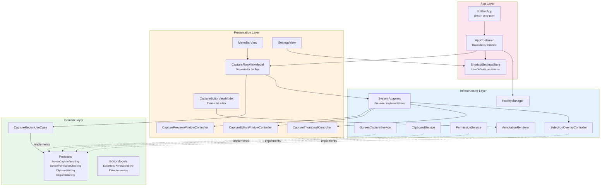
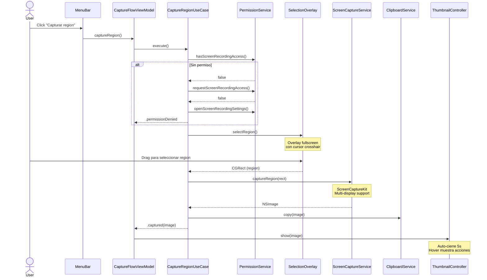
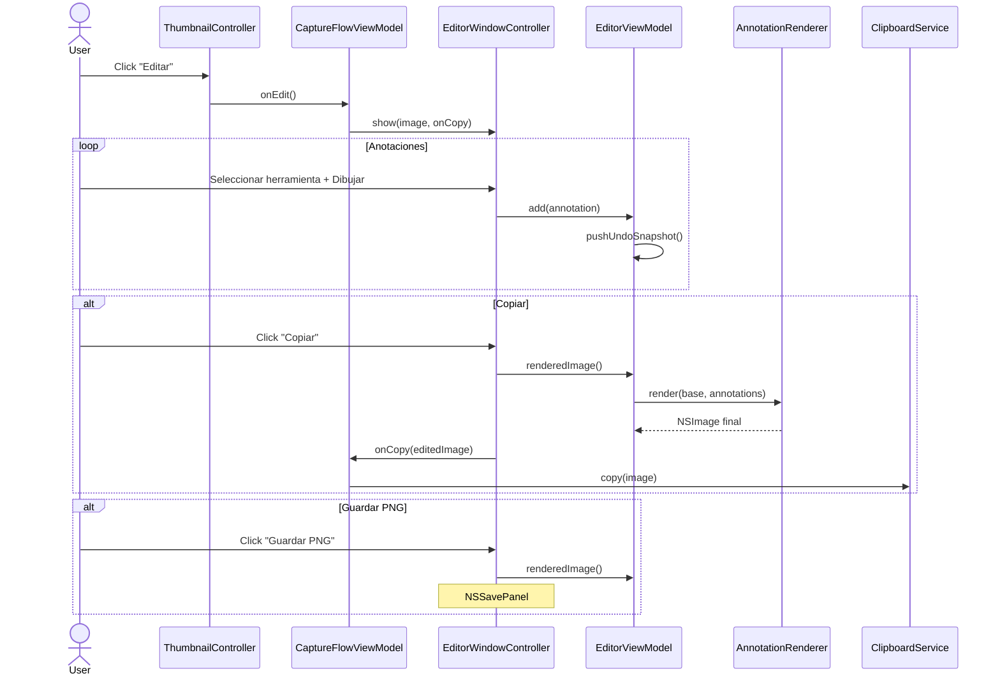
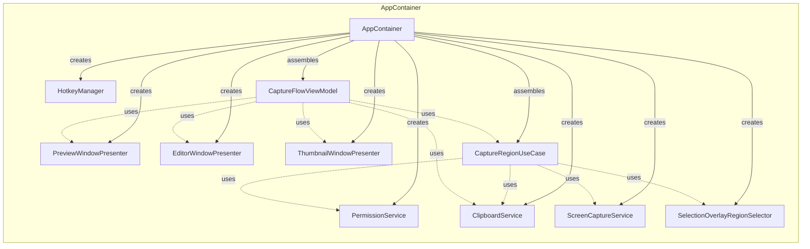
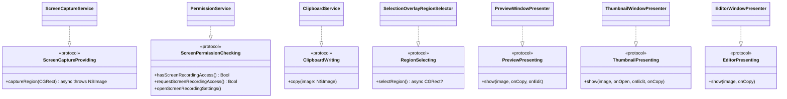
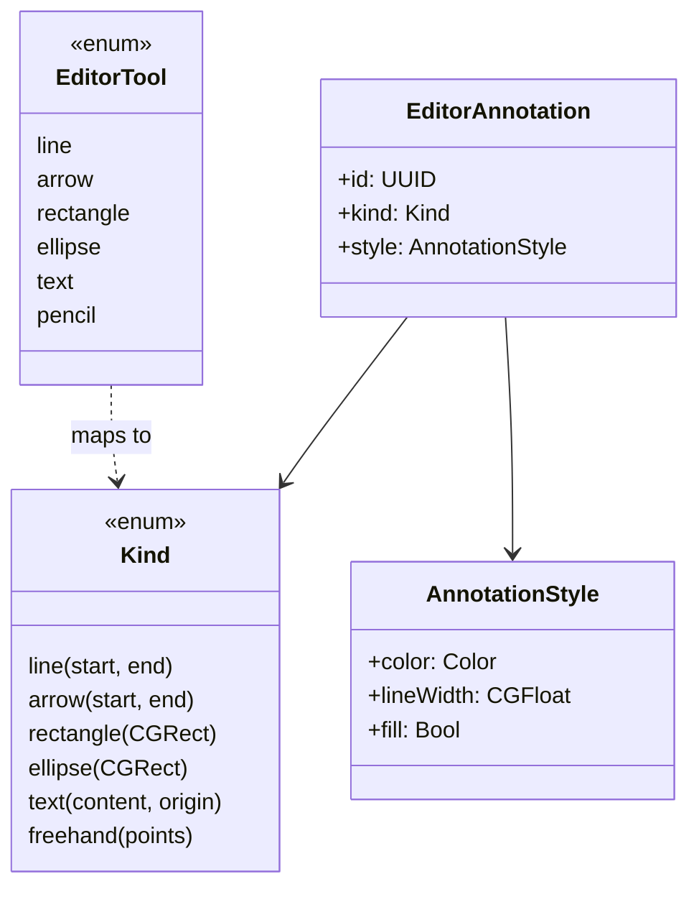

# Arquitectura de sb-shot

Herramienta de captura de pantalla para macOS con editor de anotaciones integrado.

## Stack Tecnologico

| Tecnologia | Uso |
|---|---|
| Swift 6 | Lenguaje principal |
| SwiftUI | Vistas declarativas (menus, settings, editor UI) |
| AppKit | Window controllers, NSPanel, NSPasteboard |
| ScreenCaptureKit | Captura de pantalla multi-monitor |
| Carbon Events | Atajos de teclado globales |
| CoreGraphics | Renderizado de anotaciones para exportacion |

## Estructura de Capas

El proyecto sigue **Clean Architecture** con 4 capas bien definidas:

```
┌──────────────────────────────────────────┐
│              App (Entry Point)           │
│   SbShotApp · AppContainer · Settings    │
├──────────────────────────────────────────┤
│           Presentation (UI)              │
│  ViewModels · WindowControllers · Views  │
├──────────────────────────────────────────┤
│       Infrastructure (Servicios)         │
│   Capture · Clipboard · Hotkey · Perms   │
├──────────────────────────────────────────┤
│         Domain (Logica de negocio)       │
│   Contracts · Models · Use Cases         │
└──────────────────────────────────────────┘
```

### Diagrama de Capas



## Flujo de Captura



## Flujo del Editor



## Inyeccion de Dependencias



## Protocolos (Contracts)

Todos los servicios implementan protocolos definidos en el dominio, permitiendo testabilidad y desacoplamiento:



## Modelo de Anotaciones



## Estructura de Archivos

```
sb-shot/
├── App/
│   ├── SbShotApp.swift              # @main, MenuBarExtra, Settings scene
│   ├── AppContainer.swift           # DI container, wiring de dependencias
│   └── ShortcutSettingsStore.swift   # Persistencia del atajo global
│
├── Domain/
│   ├── CaptureContracts.swift       # 4 protocolos del dominio
│   ├── EditorModels.swift           # EditorTool, AnnotationStyle, EditorAnnotation
│   └── CaptureRegionUseCase.swift   # Logica: permisos → seleccion → captura → clipboard
│
├── Infrastructure/
│   ├── Capture/
│   │   └── ScreenCaptureService.swift      # ScreenCaptureKit, multi-display
│   ├── Clipboard/
│   │   └── ClipboardService.swift          # NSPasteboard wrapper
│   ├── Hotkey/
│   │   └── HotkeyManager.swift             # Carbon Events, registro de hotkeys
│   ├── Permissions/
│   │   └── PermissionService.swift         # CGPreflightScreenCaptureAccess
│   ├── Rendering/
│   │   ├── AnnotationRenderer.swift        # CoreGraphics rendering a NSImage
│   │   ├── ArrowGeometry.swift             # Calculo geometrico compartido de flechas
│   │   └── ImageExporter.swift             # Exportacion PNG via NSSavePanel
│   ├── Selection/
│   │   └── SelectionOverlayController.swift # Overlay fullscreen + drag selection
│   └── SystemAdapters.swift                # Implementaciones de Presenter protocols
│
└── Presentation/
    ├── CapturePresenting.swift             # Protocolos de presentacion
    ├── Capture/
    │   └── CaptureFlowViewModel.swift      # Orquestador principal del flujo
    ├── Editor/
    │   ├── CaptureEditorViewModel.swift    # Estado del editor, undo/redo
    │   └── CaptureEditorWindowController.swift # Ventana del editor + canvas
    ├── MenuBar/
    │   └── MenuBarView.swift               # Menu de la barra de estado
    ├── Preview/
    │   └── CapturePreviewWindowController.swift # Ventana de vista previa
    ├── Settings/
    │   └── SettingsView.swift              # Configuracion del atajo global
    └── Thumbnail/
        └── CaptureThumbnailController.swift # Thumbnail flotante post-captura
```

## Patrones Utilizados

| Patron | Donde | Proposito |
|---|---|---|
| Clean Architecture | Todo el proyecto | Separacion de capas |
| Use Case | `CaptureRegionUseCase` | Orquestar logica de negocio |
| Protocol-Based Design | `CaptureContracts`, `CapturePresenting` | Desacoplamiento, testabilidad |
| Dependency Injection | `AppContainer` | Composicion de dependencias |
| Observable/MVVM | `CaptureFlowViewModel`, `CaptureEditorViewModel` | State management reactivo |
| Presenter | `SystemAdapters` | Gestionar ciclo de vida de ventanas |
| Undo/Redo Stack | `CaptureEditorViewModel` | Historial de edicion (max 100) |

## Como Contribuir

### Prerequisitos

- macOS 14+ (Sonoma)
- Xcode 16+
- Swift 6

### Herramientas de Calidad

```bash
# Formatear codigo
swiftformat sb-shot/ sb-shotTests/ sb-shotUITests/

# Lint
swiftlint lint

# Lint con auto-correccion
swiftlint lint --fix
```

### Agregar un Nuevo Servicio

1. Definir el protocolo en `Domain/CaptureContracts.swift`
2. Implementar en `Infrastructure/NuevoServicio/`
3. Agregar conformance con extension: `extension MiServicio: MiProtocolo {}`
4. Registrar en `AppContainer`

### Agregar una Nueva Herramienta de Editor

1. Agregar caso a `EditorTool` en `Domain/EditorModels.swift`
2. Agregar caso a `EditorAnnotation.Kind`
3. Implementar rendering en `AnnotationRenderer` (para export PNG)
4. Implementar rendering en `CaptureEditorCanvasView` (para preview en canvas)
5. Agregar gesture handling en `editorGesture` / `commitDrag` / `annotationForDrag`
6. Agregar preview en `previewAnnotation()`

### Convenciones

- **Idioma del codigo**: Ingles para identificadores, espanol para strings de UI
- **Formato**: SwiftFormat con `.swiftformat` del proyecto
- **Lint**: SwiftLint con `.swiftlint.yml` del proyecto
- **Arquitectura**: Respetar la separacion de capas (Domain no importa frameworks)
- **Window Controllers**: Usar patron `init → super.init → show()` existente
- **Protocolos**: Implementar conformance como extension separada
