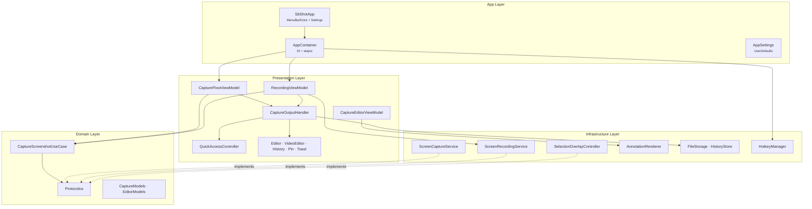
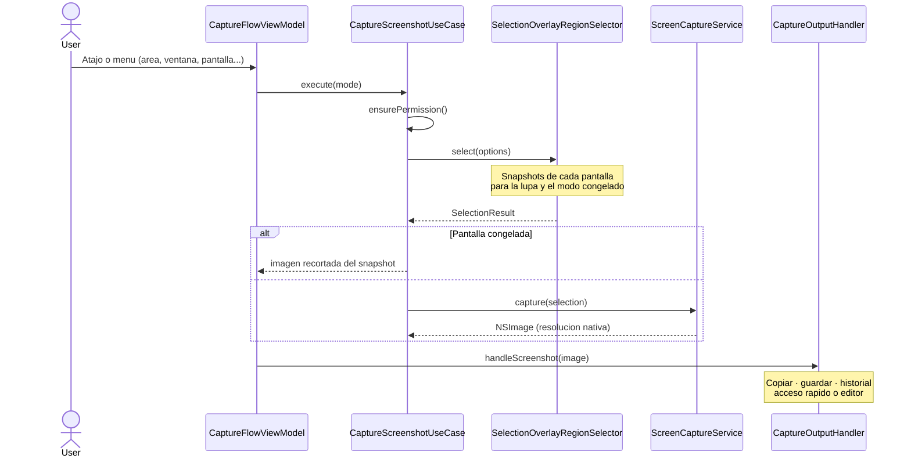
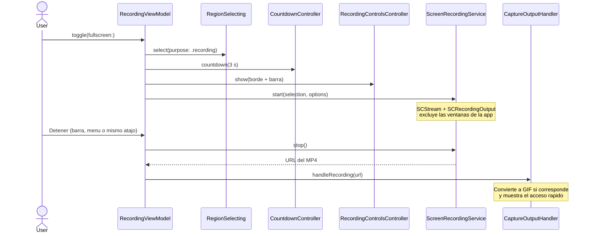

# Arquitectura de sb-shot

Herramienta de captura y grabacion de pantalla para macOS (alternativa a CleanShot X) con editor de anotaciones, editor de video, acceso rapido e historial.

## Funcionalidades

| Area | Que incluye |
|---|---|
| Captura | Area, area anterior, pantalla completa, ventana (con o sin sombra), temporizador (3/5/10 s), texto con OCR (Vision) |
| Seleccion | Modo inteligente: arrastrar = area, clic = ventana bajo el cursor, clic en el escritorio o Enter = pantalla completa. Una ventana de overlay por pantalla, reticula, lupa con pixeles y color, medidas en vivo, mantener Espacio para mover, Shift para cuadrado, pantalla congelada opcional |
| Grabacion | Area, pantalla o ventana a MP4 (H.264) o GIF, 24/30/60 fps, cursor, resaltado de clics, audio del sistema, microfono, cuenta regresiva, barra de control (detener, reiniciar, descartar) |
| Acceso rapido | Pila de miniaturas con Copiar, Guardar, Anotar, Fijar, arrastrar y soltar, deslizar para descartar, cierre automatico configurable |
| Editor | Seleccionar/mover/redimensionar, flecha, linea, rectangulo, elipse, texto sobre el lienzo, contador numerado, lapiz, resaltador, pixelar/desenfocar, foco, recorte, fondo con degradado/margen/esquinas/sombra, deshacer, atajos de teclado |
| Video | Recortar (AVKit), quitar audio, exportar MP4 o GIF |
| Otros | Capturas fijadas flotantes, historial, guardado automatico con carpeta elegible, PNG/JPEG, atajo global por accion, abrir al iniciar sesion |

## Stack Tecnologico

| Tecnologia | Uso |
|---|---|
| Swift / SwiftUI | Vistas (menu, ajustes, editor, acceso rapido) |
| AppKit | Ventanas, paneles flotantes, overlay de seleccion, arrastrar y soltar |
| ScreenCaptureKit | Capturas (`SCScreenshotManager`) y grabacion (`SCStream` + `SCRecordingOutput`) |
| AVFoundation / AVKit | Recorte, exportacion y miniaturas de video |
| ImageIO | Exportacion a GIF |
| CoreGraphics / CoreImage | Render de anotaciones, pixelado y desenfoque |
| Vision | Reconocimiento de texto |
| Carbon Events | Atajos globales |
| ServiceManagement | Abrir al iniciar sesion |

## Estructura de Capas

```
┌──────────────────────────────────────────┐
│              App (Entry Point)           │
│   SbShotApp · AppContainer · AppSettings │
├──────────────────────────────────────────┤
│           Presentation (UI)              │
│  ViewModels · WindowControllers · Views  │
├──────────────────────────────────────────┤
│       Infrastructure (Servicios)         │
│ Capture · Recording · Selection · Files  │
├──────────────────────────────────────────┤
│         Domain (Logica de negocio)       │
│   Contracts · Models · Use Cases         │
└──────────────────────────────────────────┘
```



## Flujo de Captura



## Flujo de Grabacion



## Editor

El editor guarda un `EditorDocument` (anotaciones, recorte y fondo). Deshacer/rehacer guarda copias completas del documento (maximo 100) y agrupa los cambios seguidos de un mismo slider.

`AnnotationRenderer` dibuja el documento con CoreGraphics en un contexto con el eje Y hacia abajo. Lo usan:

- `EditorCanvasView` (dentro de `Canvas.withCGContext`, con una imagen base reducida para ir fluido)
- La exportacion (`render(document:sources:)`, a resolucion completa)

Asi lo que se ve en el lienzo coincide con la imagen copiada o guardada. `RenderLayout` traduce entre coordenadas de la imagen y del lienzo de salida (recorte + margen del fondo).

## Estructura de Archivos

```
sb-shot/
├── App/
│   ├── SbShotApp.swift              # MenuBarExtra (estilo menu) + Settings
│   ├── AppContainer.swift           # DI, enrutado de acciones y atajos
│   └── AppSettings.swift            # Preferencias y atajos por accion
├── Domain/
│   ├── CaptureContracts.swift       # Protocolos del dominio
│   ├── CaptureModels.swift          # Acciones, selecciones, opciones, CaptureItem
│   ├── CaptureScreenshotUseCase.swift
│   └── EditorModels.swift           # Herramientas, anotaciones, documento, fondo
├── Infrastructure/
│   ├── Capture/ScreenCaptureService.swift
│   ├── Recording/                   # ScreenRecordingService, VideoProcessing (GIF/MP4), ClickHighlighter
│   ├── Selection/SelectionOverlayController.swift
│   ├── Rendering/                   # AnnotationRenderer, RenderSources, AnnotationGeometry, ArrowGeometry
│   ├── Files/FileStorage.swift      # Temporales, carpeta de guardado (bookmark), codificacion
│   ├── History/HistoryStore.swift
│   ├── Clipboard/ClipboardService.swift
│   ├── Hotkey/HotkeyManager.swift
│   ├── Permissions/PermissionService.swift
│   ├── System/SystemServices.swift  # Sonido, inicio de sesion, OCR
│   └── SystemAdapters.swift         # Selector y presentadores de ventanas
└── Presentation/
    ├── CapturePresenting.swift      # Protocolos y acciones de presentacion
    ├── Capture/                     # CaptureFlowViewModel, CaptureOutputHandler
    ├── Recording/                   # RecordingViewModel, barra de control, cuenta regresiva
    ├── Editor/                      # ViewModel, lienzo, ventana, barra de herramientas
    ├── VideoEditor/                 # Recorte y exportacion de video
    ├── QuickAccess/                 # Miniaturas flotantes apiladas
    ├── Pin/                         # Capturas fijadas
    ├── History/                     # Ventana de historial
    ├── Toast/                       # Avisos breves
    ├── MenuBar/MenuBarView.swift
    ├── Settings/SettingsView.swift  # General, Captura, Grabacion, Acceso rapido, Atajos
    └── Shared/                      # Estilos, formato de atajos, FileDragSource
```

## Sandbox y Permisos

| Permiso | Para que |
|---|---|
| Grabacion de pantalla (TCC) | Capturas y grabaciones |
| Microfono (`device.audio-input`) | Grabar voz |
| Imagenes (`assets.pictures.read-write`) | Carpeta por defecto `~/Pictures/sb-shot` |
| Archivos elegidos (`files.user-selected.read-write`) | Guardar como, carpeta personalizada |
| Bookmarks (`files.bookmarks.app-scope`) | Recordar la carpeta personalizada |

## Como Contribuir

### Prerequisitos

- macOS 15+
- Xcode 26+

### Herramientas de Calidad

```bash
swiftformat sb-shot/ sb-shotTests/ sb-shotUITests/
swiftlint lint
xcodebuild test -scheme SbShot -only-testing:SbShotTests

# Pruebas reales de captura y grabacion (pantalla desbloqueada y permiso concedido)
TEST_RUNNER_SBSHOT_INTEGRATION=1 xcodebuild test -scheme SbShot -only-testing:SbShotTests/RecordingIntegrationTests
```

### Agregar una Nueva Herramienta de Editor

1. Agregar caso a `EditorTool` (icono, titulo y tecla) y a `EditorAnnotation.Kind`
2. Implementar geometria (`bounds`, `hitTest`, `translated`, `handles`) en `AnnotationGeometry`
3. Dibujarla en `AnnotationRenderer` (sirve para el lienzo y la exportacion)
4. Crearla desde el arrastre en `CaptureEditorViewModel.annotation(start:end:points:)`

### Convenciones

- **Idioma del codigo**: ingles para identificadores, espanol para textos de la interfaz
- **Formato**: SwiftFormat con `.swiftformat`; **Lint**: SwiftLint con `.swiftlint.yml`
- **Arquitectura**: respetar la separacion de capas; servicios detras de protocolos del dominio
- **Ventanas de la app**: excluidas de capturas y grabaciones (salvo el resaltado de clics)
