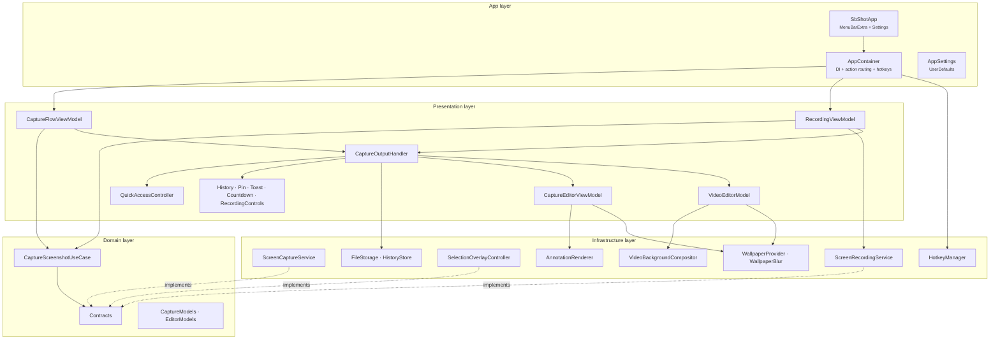
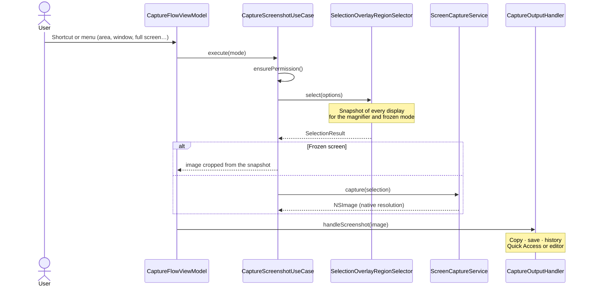
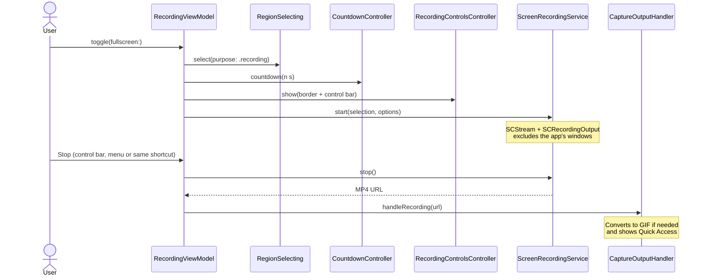

# sb-shot Architecture

sb-shot is a macOS menu bar app (`LSUIElement`, sandboxed) for screenshots and screen recordings, with an annotation editor, a video editor, Quick Access and history. This document describes how the code is organized and how the main flows work. For build instructions see [README.md](README.md); for contribution rules see [CONTRIBUTING.md](CONTRIBUTING.md).

## Features at a glance

| Area | What it includes |
|---|---|
| Capture | Area, previous area, full screen, window (with or without shadow), timer (3/5/10 s), text recognition (Vision OCR), annotate an existing image file |
| Selection | Smart mode: drag = area, click = window under the cursor, click on the desktop or Enter = full display. One overlay window per display, crosshair, magnifier with pixels and color, live dimensions, hold Space to move, Shift for a square, optional frozen screen |
| Recording | Area, display or window to MP4 (H.264) or GIF, 24/30/60 fps, cursor, click highlighting, system audio, microphone, countdown, control bar (stop, restart, discard) |
| Quick Access | Stack of thumbnails with Copy, Save, Annotate, Pin, drag and drop, swipe to dismiss, configurable auto-close |
| Editor | Select/move/resize, arrow, line, rectangle, ellipse, on-canvas text, numbered counter, pencil, highlighter, pixelate/blur, spotlight, crop, background (gradient or wallpaper with blur, padding, corners, shadow, aspect ratio), undo/redo, keyboard shortcuts |
| Video editor | Trim (filmstrip + I/O keys), background compositing, export to MP4 (720p/1080p/original, 24/30/60 fps, with or without audio) or GIF (480/720/960 px, 10/15/24 fps) |
| Other | Floating pinned captures, history (last 100 items), auto-save to a chosen folder, PNG/JPEG, one global shortcut per action, launch at login, English + Spanish UI |

## Technology stack

| Technology | Used for |
|---|---|
| Swift / SwiftUI | Views (menu, settings, editor, video editor, Quick Access, history) |
| AppKit | Windows, floating panels, selection overlay, drag and drop, key monitoring |
| ScreenCaptureKit | Screenshots (`SCScreenshotManager`), recording (`SCStream` + `SCRecordingOutput`), wallpaper capture |
| AVFoundation / AVKit | Playback, trimming, MP4 export, video compositions, thumbnails |
| ImageIO | GIF encoding, image downsampling |
| CoreGraphics / CoreImage | Annotation rendering, pixelate/blur, wallpaper blur, video background compositing |
| Vision | Text recognition (`VNRecognizeTextRequest`) |
| Carbon Events | Global hotkeys |
| ServiceManagement | Launch at login (`SMAppService`) |
| String Catalogs | Localization (`Localizable.xcstrings`) |

Build settings worth knowing: Swift language mode 5 with the Xcode 26 toolchain, `SWIFT_DEFAULT_ACTOR_ISOLATION = MainActor` and `SWIFT_APPROACHABLE_CONCURRENCY = YES`. Code is main-actor isolated by default; types and functions that must run in the background (rendering, encoding, GIF/MP4 export, wallpaper blur) are explicitly marked `nonisolated`.

## Layers

```
┌──────────────────────────────────────────┐
│              App (entry point)           │
│   SbShotApp · AppContainer · AppSettings │
├──────────────────────────────────────────┤
│            Presentation (UI)             │
│  ViewModels · WindowControllers · Views  │
├──────────────────────────────────────────┤
│        Infrastructure (services)         │
│ Capture · Recording · Selection · Render │
│ Files · History · Wallpaper · Hotkeys    │
├──────────────────────────────────────────┤
│        Domain (business logic)           │
│     Contracts · Models · Use cases       │
└──────────────────────────────────────────┘
```

- **Domain** has no UI. It defines the models (`CaptureModels`, `EditorModels`), the contracts that infrastructure implements (`ScreenCaptureProviding`, `RegionSelecting`, `ScreenRecording`, `ScreenPermissionChecking`, `TextRecognizing`, `CountdownPresenting`…) and `CaptureScreenshotUseCase`.
- **Infrastructure** implements those contracts with system frameworks and holds helpers such as the renderer and the video compositor.
- **Presentation** contains view models, window controllers and SwiftUI views. Presentation protocols (`QuickAccessPresenting`, `EditorPresenting`, `PinPresenting`, `ToastPresenting`, `HistoryPresenting`…) live in `Presentation/CapturePresenting.swift` so view models can be tested with fakes.
- **App** wires everything together. `AppContainer` is the composition root: it creates every service once, injects them, routes `CaptureAction`s and re-registers global hotkeys whenever settings change.



## Entry point and settings

- `SbShotApp` declares a `MenuBarExtra` (menu style) and a `Settings` scene. `AppDelegate` sets the activation policy to `.accessory`, so there is no Dock icon.
- `AppSettings` is an `ObservableObject` whose properties use the `@Preference` property wrapper: each value is stored as JSON in `UserDefaults` under a stable key (`general.*`, `capture.*`, `recording.*`, `quickAccess.*`, `shortcuts`). It also derives `SelectionOptions`, `CaptureOptions` and `RecordingOptions` for the flows.
- Shortcuts are stored per `CaptureAction`. A missing entry means "use `CaptureAction.defaultShortcut`"; an explicit `nil` means "disabled by the user". Assigning a shortcut removes it from any other action.
- `HotkeyManager` registers Carbon hotkeys. While the user records a new shortcut in Settings, all hotkeys are unregistered. Shortcuts that fail to register (taken by another app) are published in `AppSettings.unavailableShortcuts` and flagged in the UI.

## Capture flow



- **Permission.** `ensurePermission()` uses `CGPreflightScreenCaptureAccess` / `CGRequestScreenCaptureAccess`. The first time, the system prompt is shown; on later attempts System Settings is opened at the Screen Recording pane.
- **Selection.** `SelectionOverlayRegionSelector` (in `Infrastructure/SystemAdapters.swift`) takes a snapshot of each display and opens one `SelectionOverlayController` window per display. The overlay implements the smart mode (drag for an area, click for the window or display under the cursor), the magnifier, live dimensions, Space-to-move and Shift-for-square. A busy flag prevents two overlays when a shortcut is pressed twice in a row. Focus is returned to the previously active app afterwards.
- **Modes.** Full screen skips the overlay and uses the display under the cursor. Previous area reuses `AppSettings.lastCaptureArea`. Timed captures disable frozen mode and show `CountdownController` over the selection before capturing.
- **Capture.** `ScreenCaptureService` uses `SCScreenshotManager` and excludes the app's own windows. Window captures can include the full-size window shadow; areas spanning several displays are captured per display and joined off the main thread, and fully transparent margins are trimmed. Optionally the result is downscaled to 1x.
- **Text (OCR).** `captureText()` selects an area, captures it and runs `TextRecognitionService` (Vision, accurate level, automatic language detection); `CaptureOutputHandler.handleRecognizedText` copies the result.

## Recording flow



- `RecordingViewModel` is a small state machine (`idle → preparing → recording → processing`). The same action starts and stops a recording; `restart()` and `cancel()` are available from the control bar and the menu. The menu bar label shows the elapsed time.
- If the microphone is enabled, access is requested first; without it, the recording continues without voice and a toast explains why.
- `ScreenRecordingService` configures `SCStream` (frame rate, cursor, Retina scale, system audio with `excludesCurrentProcessAudio`, microphone) and writes straight to an MP4 file with `SCRecordingOutput` (H.264, even dimensions). The filter excludes the whole app instead of individual windows, because new windows may not be listed in `SCShareableContent` yet; the only exception is the click highlighter (`ClickHighlighter`), which must appear in the video. If the stream stops on its own (for example, the recorded window is closed), `onUnexpectedStop` reports it.

## Output handling

`CaptureOutputHandler` decides what happens with each result according to the settings, and implements the actions of Quick Access, the editors, pins and history.

- **Screenshots** are processed in order through a task chain, so file names and clipboard contents never interleave. The image is encoded once off the main thread; the same bytes are used for the temporary file and the clipboard (PNG data plus the file URL).
- Then, depending on the settings: auto-save to the save folder, add to history, and either open the editor or show Quick Access (or a toast when both are off).
- **Recordings** are moved to a named temporary file, a thumbnail is generated, and if the format is GIF the video is converted with `GifExporter` (if conversion fails, the MP4 is kept). Then the same auto-save / history / Quick Access steps apply.
- **Saving** goes through `FileStorage`: temporary files live in the sandbox temporary directory (stale ones are removed at launch), the default save folder is `~/Pictures/sb-shot`, and a custom folder is stored as a security-scoped bookmark. If the bookmark can no longer be resolved, the app falls back to the default folder and shows a toast. Saving the same Quick Access item twice does not create duplicates.
- **Quick Access** (`QuickAccessController`) shows floating cards stacked in a corner, with auto-close, drag-out (`FileDragSource`) and swipe to dismiss. Pins (`PinnedImageController`) are floating windows with zoom (scroll / pinch), opacity and a context menu. Toasts (`ToastController`) show short messages and progress.

## Annotation editor and rendering pipeline

The editor (`CaptureEditorViewModel`, `CaptureEditorWindowController`, `EditorCanvasView`) edits an `EditorDocument`: a list of `EditorAnnotation`s, an optional crop rectangle and `BackgroundSettings`. Annotations are stored in image coordinates (points of the original image).

- **Undo/redo** stores full copies of the document (at most 100 steps). Consecutive changes with the same coalescing key (a slider, the color picker) within a second are grouped into one step. A newly created text that ends up empty is discarded together with its undo step.
- **One renderer for canvas and export.** `AnnotationRenderer` draws a document with CoreGraphics in a context whose Y axis points down. It is used by:
  - `EditorCanvasView`, inside `Canvas.withCGContext`, with a downscaled base image so interaction stays smooth;
  - export (`render(document:sources:)` / `renderImage(document:sources:)`), at full resolution and off the main thread.

  What you see on the canvas is therefore exactly what gets copied, saved, pinned or dragged.
- `RenderLayout` maps between image coordinates and the output canvas (crop + background padding + aspect ratio). `EditorCanvasView` adds the view scale and offset on top.
- `RenderSources` holds the base image and its derived variants (pixelated, blurred) used by the obfuscation tool. Each variant is computed once, behind its own lock, and can be prepared in the background before it is first drawn.
- `AnnotationGeometry` and `ArrowGeometry` implement bounds, hit testing, translation and handle-based resizing for every annotation kind.
- The last full render is cached and reused while the document does not change (for example, for drag and drop, which needs a file synchronously).

## Backgrounds, wallpaper provider and video compositor

Both editors share `BackgroundSettings`: a gradient preset or the user's wallpaper (with blur), padding, corner radius, shadow and aspect ratio.

- **`WallpaperProvider`** (shared, observable) obtains the current desktop wallpaper of the display under the cursor. In the sandbox the wallpaper file is not always readable, so it captures the Dock's `Wallpaper-*` windows with ScreenCaptureKit (which also works for dynamic wallpapers) and falls back to reading the file from `NSWorkspace.desktopImageURL(for:)`. Loading happens off the main thread, concurrent requests share one task, and a result is reused for 30 seconds for the same display. A small thumbnail is produced for the picker (`WallpaperTile`).
- **`WallpaperBlur`** produces blurred and/or downsampled versions with Core Image. The blur radius is defined relative to a 1600 px reference image so it looks the same at any output size, the working size is rounded up in steps to avoid recomputing on small canvas changes, and the last few results are cached (thread-safe).
- **Images:** `AnnotationRenderer` draws the background (gradient or aspect-filled wallpaper, shadow, rounded corners) as part of the pipeline described above.
- **Videos:** `VideoBackgroundCompositor` computes a `Layout` (even render size for H.264, content rect, unit scale relative to a 1600 px reference) and builds an `AVVideoComposition` with a Core Image handler. The background (gradient or image plus blurred shadow) is rasterized once, and each frame is blended over it through a rounded-rectangle mask. The same composition is used for:
  - playback in the video editor (applied to the `AVPlayerItem`, debounced while sliders move),
  - MP4 export (`VideoExporter`),
  - GIF export (`GifExporter`).

## Video editor

`VideoEditorModel` and `VideoEditorWindowController` provide playback (`AVPlayer`), a filmstrip trim bar with handles, I/O keys to set the trim at the playhead, and an export panel.

- `VideoExporter` builds an `AVMutableComposition` for the trimmed range (optionally without audio), applies the maximum height, frame rate and background, and exports MP4.
- `GifExporter` samples frames with `AVAssetImageGenerator` and encodes them with ImageIO. Because ImageIO keeps every frame in memory until finalizing, the number of frames is capped and long ranges are spread across that budget.
- If nothing changed (no trim, no background, original quality and frame rate, audio kept), the original file is returned without re-encoding. Each export goes to its own temporary folder.
- When opened from history, the editor works on a temporary copy, so deleting or trimming the history does not affect it.

## History store

`HistoryStore` keeps a copy of each capture and recording in `Application Support/sb-shot/History` (inside the app container) with an `index.json` file.

- The limit is 100 entries; older files are deleted.
- The index is decoded entry by entry (`LossyHistoryEntry`), so one corrupt entry does not invalidate the rest. If the index cannot be read or backed up, the store stops persisting instead of overwriting it.
- History copies are taken from the temporary file, not from the save folder, because a custom folder is only accessible through its bookmark.
- The history window (`HistoryWindowController`) shows a grid with copy, open (editor or video editor), reveal in Finder and delete. Settings can disable the history or clear it.

## Localization

- The development language is English; Spanish is the second localization (`knownRegions = en, es`).
- All UI strings live in one String Catalog, `sb-shot/Localizable.xcstrings`; `Info.plist` strings (for example `NSMicrophoneUsageDescription`) are localized in `sb-shot/InfoPlist.xcstrings`. `SWIFT_EMIT_LOC_STRINGS` and `LOCALIZATION_PREFERS_STRING_CATALOGS` are enabled, so Xcode extracts strings into the catalog on build.
- SwiftUI literals (`Text("…")`, `Button("…")`, `Toggle("…")`) are `LocalizedStringKey`s and are localized automatically.
- Strings built in code (titles of enums such as `CaptureAction.title` or `EditorTool.title`, toast messages, window titles, AppKit labels, file names) use `String(localized:)`.

## File layout

```
sb-shot/
├── App/
│   ├── SbShotApp.swift              # MenuBarExtra (menu style) + Settings
│   ├── AppContainer.swift           # Composition root, action routing, hotkeys
│   └── AppSettings.swift            # @Preference-backed settings and per-action shortcuts
├── Domain/
│   ├── CaptureContracts.swift       # Domain protocols
│   ├── CaptureModels.swift          # Actions, selections, options, CaptureItem
│   ├── CaptureScreenshotUseCase.swift
│   └── EditorModels.swift           # Tools, annotations, document, background
├── Infrastructure/
│   ├── Capture/ScreenCaptureService.swift
│   ├── Recording/                   # ScreenRecordingService, VideoProcessing (GIF/MP4),
│   │                                # VideoBackgroundCompositor, ClickHighlighter
│   ├── Selection/SelectionOverlayController.swift
│   ├── Rendering/                   # AnnotationRenderer, RenderSources, AnnotationGeometry, ArrowGeometry
│   ├── Files/FileStorage.swift      # Temporary files, save folder (bookmark), encoding
│   ├── History/HistoryStore.swift
│   ├── Clipboard/ClipboardService.swift
│   ├── Hotkey/HotkeyManager.swift
│   ├── Permissions/PermissionService.swift
│   ├── System/SystemServices.swift  # Sound, launch at login, OCR
│   ├── System/WallpaperProvider.swift  # Wallpaper capture + WallpaperBlur
│   └── SystemAdapters.swift         # Region selector, focus handling, editor presenters
├── Presentation/
│   ├── CapturePresenting.swift      # Presentation protocols and action bundles
│   ├── Capture/                     # CaptureFlowViewModel, CaptureOutputHandler
│   ├── Recording/                   # RecordingViewModel, control bar, countdown
│   ├── Editor/                      # View model, canvas, window, toolbar and inspector
│   ├── VideoEditor/                 # Playback, trimming, background and export
│   ├── QuickAccess/                 # Stacked floating thumbnails
│   ├── Pin/                         # Pinned captures
│   ├── History/                     # History window
│   ├── Toast/                       # Short notifications
│   ├── MenuBar/MenuBarView.swift
│   ├── Settings/SettingsView.swift  # General, Capture, Recording, Quick Access, Shortcuts
│   └── Shared/                      # Styles, shortcut formatting, FileDragSource, WallpaperTile
├── Localizable.xcstrings            # UI String Catalog (English + Spanish)
└── InfoPlist.xcstrings              # Info.plist strings (English + Spanish)

sb-shotTests/                        # Unit tests (Swift Testing) + opt-in integration tests
sb-shotUITests/                      # UI test target (launch tests)
```

## Sandbox and permissions

| Permission | Why |
|---|---|
| Screen Recording (TCC) | Captures, recordings, selection snapshots, wallpaper capture |
| Microphone (`device.audio-input`) | Recording voice |
| Pictures (`assets.pictures.read-write`) | Default folder `~/Pictures/sb-shot` |
| User-selected files (`files.user-selected.read-write`) | Save As, custom folder |
| Bookmarks (`files.bookmarks.app-scope`) | Remember the custom folder |

The app's own windows are excluded from captures and recordings (except the click highlight during recordings).

## Tests

- `sb-shotTests` (target `SbShotTests`) uses Swift Testing. It covers the capture use case with fakes, the selector busy flag, image processing, output handling, editor undo coalescing and empty text, file storage, history persistence, toasts, hotkeys, wallpaper blur and GIF frame sampling.
- `RecordingIntegrationTests` performs real recordings and is enabled only when the `SBSHOT_INTEGRATION` environment variable is set (pass `TEST_RUNNER_SBSHOT_INTEGRATION=1` to `xcodebuild`).
- CI runs `-only-testing:SbShotTests` without code signing.

## Extending

### Adding an editor tool

1. Add a case to `EditorTool` (icon, localized title and shortcut key) and, if needed, to `EditorAnnotation.Kind`.
2. Implement its geometry (`bounds`, `hitTest`, `translated`, `resized(handle:to:)`) in `AnnotationGeometry`.
3. Draw it in `AnnotationRenderer` (this covers both the canvas and the export).
4. Create it from the drag gesture in `CaptureEditorViewModel.annotation(start:end:points:)`.
5. Add tests for the new behavior.

### Adding a capture action

1. Add a case to `CaptureAction` with a localized title, an SF Symbol and an optional default shortcut.
2. Route it in `AppContainer.perform(_:)`.
3. Add it to `MenuBarView`. The Shortcuts tab in Settings lists every `CaptureAction`.

### Conventions

- **Language**: English for identifiers, comments and documentation. UI strings are written in English and translated in the String Catalog.
- **Formatting**: SwiftFormat with `.swiftformat`; **linting**: SwiftLint with `.swiftlint.yml`.
- **Architecture**: keep the layer separation; services sit behind domain or presentation protocols so they can be faked in tests.
- **Own windows**: excluded from captures and recordings (except the click highlight).
