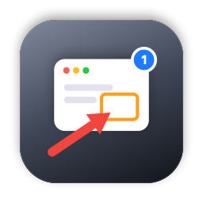
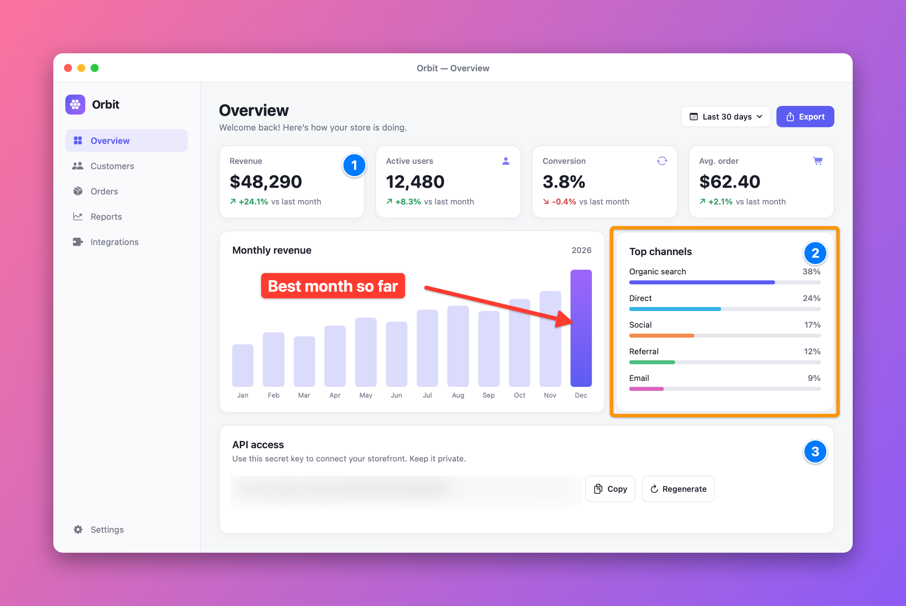
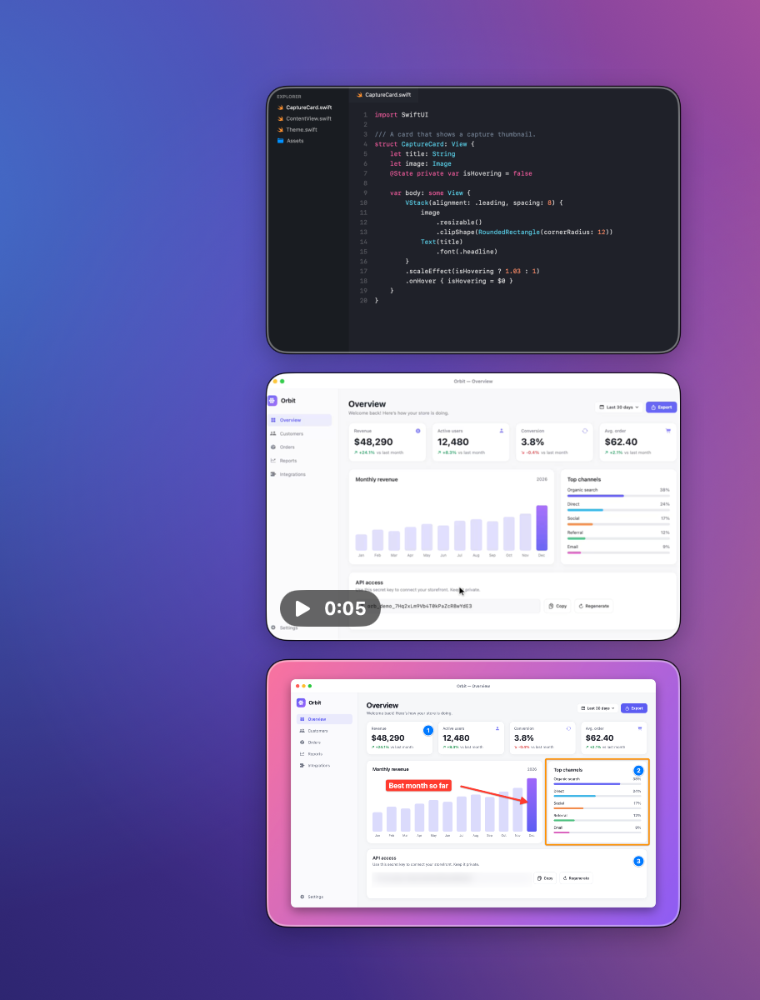
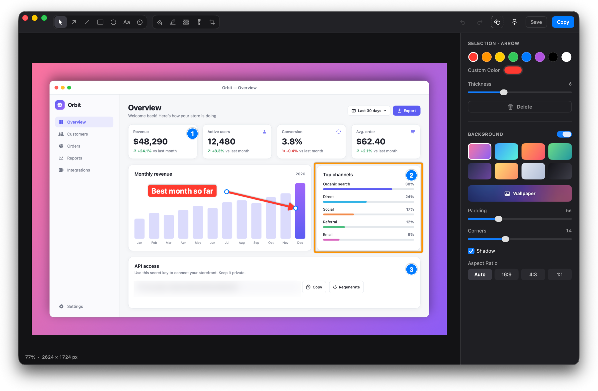
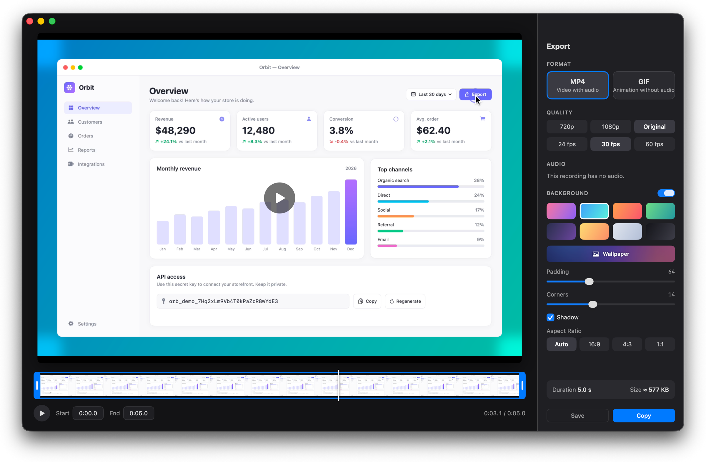
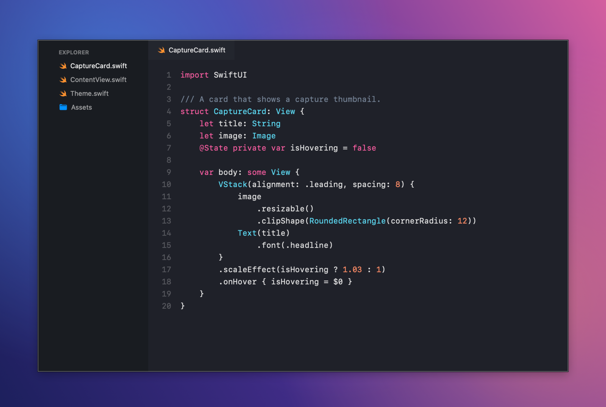
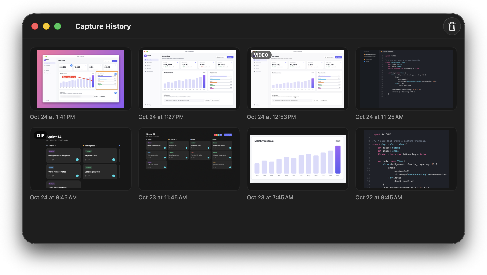
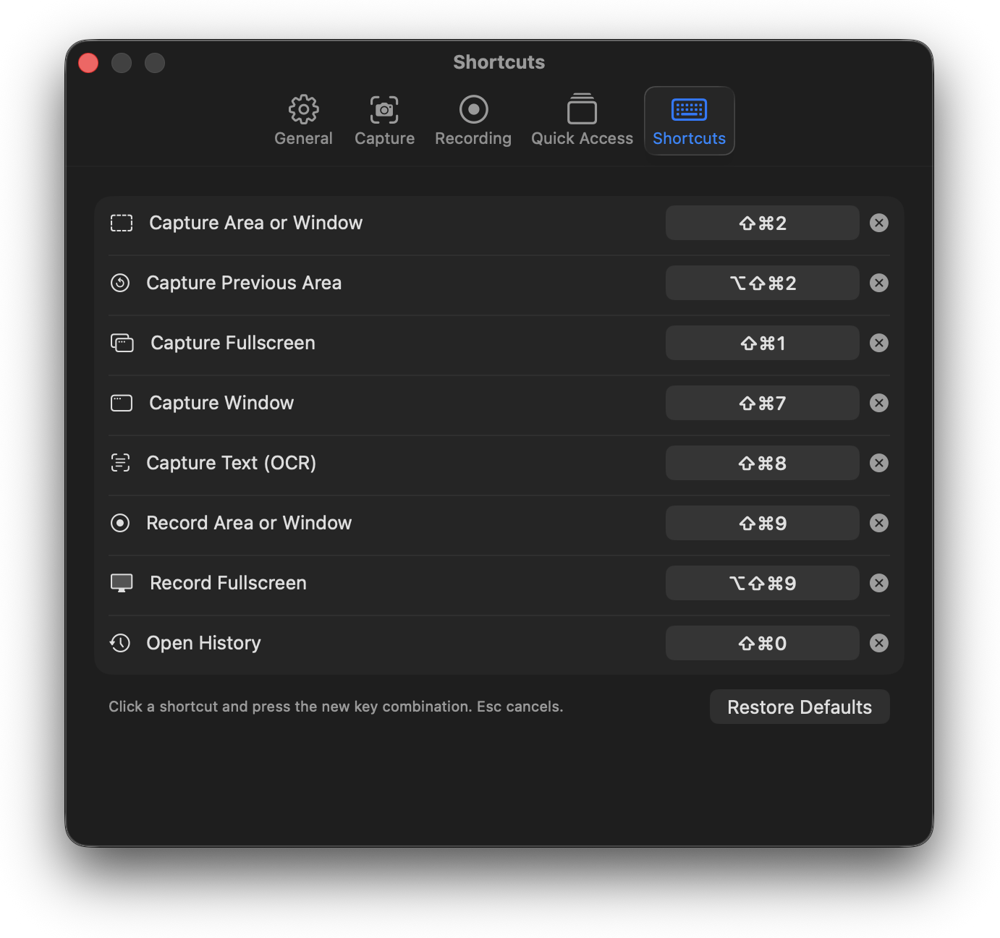

<p align="center">
  
</p>

<h1 align="center">sb-shot</h1>

<p align="center">
  <a href="https://github.com/Osmait/sb-shot/releases/latest"><strong>Download for macOS</strong></a>
</p>

A native macOS menu bar app for screenshots and screen recordings, with an annotation editor, a video editor, Quick Access and history. A free, open-source alternative to CleanShot X.

[](#requirements)
[](https://www.swift.org)
[](LICENSE)
[](https://github.com/Osmait/sb-shot/actions/workflows/ci.yml)



## Contents

- [Features](#features)
- [Default keyboard shortcuts](#default-keyboard-shortcuts)
- [Installation](#installation)
- [Permissions](#permissions)
- [Usage tips](#usage-tips)
- [Localization](#localization)
- [Development](#development)
- [Contributing](#contributing)
- [License](#license)
- [Acknowledgements](#acknowledgements)

## Features

sb-shot lives in the menu bar (it has no Dock icon). Everything is available from the menu bar icon and from global keyboard shortcuts.

### Capture

<!-- TODO: record docs/media/demo-capture.gif (see docs/media/README.md) and uncomment:
 -->

- Capture an area, the previous area again, the full screen, or a single window.
- Window captures can include the window shadow, captured at full size.
- Timed capture (3, 5 or 10 seconds) with an on-screen countdown.
- Capture text (OCR): select an area and the recognized text is copied to the clipboard (Apple Vision, automatic language detection).
- Optional frozen screen while selecting, so menus and animations are captured exactly as they looked.
- Optionally hide desktop icons and save at 1x on Retina displays.
- PNG or JPEG output, configurable file name prefix.
- Annotate an existing image file from the menu (**Annotate Image…**).
- The app's own windows (Quick Access, toasts, control bar) are excluded from captures and recordings.

### Smart selection

One overlay handles every kind of selection:

- **Drag** to select an area.
- **Click** to pick the window under the cursor.
- **Click the desktop** or press **Enter** to capture the whole display.
- Hold **Space** while dragging to move the selection, hold **Shift** for a square selection.
- **Esc** or right-click cancels.
- Crosshair, live dimensions and a magnifier with pixel grid and color value (each can be turned off in Settings).
- Works across multiple displays (one overlay per display).

### Recording

<!-- TODO: record docs/media/demo-recording.gif (see docs/media/README.md) and uncomment:
 -->

- Record an area, a window or the full screen to MP4 (H.264) or an animated GIF.
- 24, 30 or 60 fps, optional Retina quality.
- Show or hide the cursor, highlight mouse clicks.
- Record system audio and/or the microphone.
- Countdown before recording starts (none, 3 or 5 seconds).
- Control bar and selection border while recording: stop, restart or discard. The same shortcut that started a recording stops it; the menu bar icon shows the elapsed time.
- GIF settings: frame rate (10–25 fps) and maximum width (640–1920 px).

### Quick Access



After each capture or recording a thumbnail appears in a corner of the screen:

- Hover to **Copy**, **Save**, **Annotate** (or edit the video) and **Pin**.
- Drag the thumbnail into any app to drop the file.
- Click it to open the editor; swipe with two fingers to dismiss it.
- Several captures stack on top of each other.
- Position (bottom left / bottom right) and auto-close delay (never, 5 s, 10 s, 30 s, 1 min) are configurable, as well as closing after dragging to another app.

### Annotation editor



- Tools: select/move/resize, arrow, line, rectangle, ellipse, text (typed directly on the canvas, optional background), numbered counter, pencil, highlighter, pixelate/blur, spotlight and crop.
- Color (preset palette or a custom color), stroke width, fill and font size per annotation; click an existing annotation to edit it.
- Undo/redo (up to 100 steps), delete with Backspace.
- Copy, save to the capture folder, Save As, pin, or drag the result into another app.
- One-key tool shortcuts (see [Editor shortcuts](#editor)).

### Video editor



- Trim with handles on a filmstrip timeline, or set the start/end at the playhead with **I** / **O**; **Space** plays and pauses.
- Export as MP4 (720p, 1080p or original size; 24, 30 or 60 fps; include or drop audio) or GIF (480, 720 or 960 px wide; 10, 15 or 24 fps).
- Shows the trimmed duration and an estimated file size.
- Copy or save the exported file.
- Apply a background to the video (see below).

### Backgrounds

Both editors can place the capture or the video on a background:

- Eight gradient presets.
- **Your desktop wallpaper** (read from the display under the cursor, dynamic wallpapers included), with an adjustable **blur**.
- Padding, rounded corners, drop shadow and aspect ratio (Auto, 16:9, 4:3, 1:1).
- For videos, the background is composited into every frame of the preview, the MP4 export and the GIF export.

### Pin



- Pin a capture as a floating, always-on-top window.
- Zoom with the scroll wheel or a pinch gesture.
- Context menu: copy, save, annotate, opacity (100/75/50/25%), close.

### History



- Keeps a copy of your last 100 captures and recordings (images, videos and GIFs).
- Reopen an item in the editor or video editor, copy it, reveal it in Finder or delete it.
- Can be turned off and cleared from Settings. Clearing the history never touches files you saved to your own folder.

### Settings



- **General**: launch at login, capture sound, what happens after a capture (copy to clipboard, show Quick Access, open the editor directly, save automatically), save folder (default `~/Pictures/sb-shot`), image format, file name prefix, history.
- **Capture**: magnifier, crosshair, frozen screen, window shadow, hide desktop icons, 1x on Retina, and a reference of the in-selection shortcuts.
- **Recording**: format, frame rate, Retina quality, countdown, cursor, click highlighting, system audio, microphone, GIF frame rate and width.
- **Quick Access**: position, auto-close, close after drag.
- **Shortcuts**: record a new global shortcut for each action, remove it or restore the defaults. Shortcuts that another app already uses are flagged.

## Default keyboard shortcuts

### Global

All global shortcuts can be changed or removed in **Settings › Shortcuts**.

| Action | Shortcut |
|---|---|
| Capture Area or Window | <kbd>⇧</kbd><kbd>⌘</kbd><kbd>2</kbd> |
| Capture Previous Area | <kbd>⌥</kbd><kbd>⇧</kbd><kbd>⌘</kbd><kbd>2</kbd> |
| Capture Fullscreen | <kbd>⇧</kbd><kbd>⌘</kbd><kbd>1</kbd> |
| Capture Window | <kbd>⇧</kbd><kbd>⌘</kbd><kbd>7</kbd> |
| Capture Text (OCR) | <kbd>⇧</kbd><kbd>⌘</kbd><kbd>8</kbd> |
| Record Area or Window (press again to stop) | <kbd>⇧</kbd><kbd>⌘</kbd><kbd>9</kbd> |
| Record Fullscreen (press again to stop) | <kbd>⌥</kbd><kbd>⇧</kbd><kbd>⌘</kbd><kbd>9</kbd> |
| Open History | <kbd>⇧</kbd><kbd>⌘</kbd><kbd>0</kbd> |

The defaults avoid the macOS screenshot shortcuts (<kbd>⇧</kbd><kbd>⌘</kbd><kbd>3</kbd>, <kbd>4</kbd>, <kbd>5</kbd>), so both can be used side by side.

### During selection

| Key | Action |
|---|---|
| Drag | Select an area |
| Click | Pick the window under the cursor |
| Click on the desktop / <kbd>Enter</kbd> | Capture the full display |
| Hold <kbd>Space</kbd> | Move the selection while dragging |
| <kbd>Shift</kbd> | Square selection |
| <kbd>Esc</kbd> / right-click | Cancel |

### Editor

| Key | Tool / action |
|---|---|
| <kbd>V</kbd> | Select |
| <kbd>A</kbd> | Arrow |
| <kbd>L</kbd> | Line |
| <kbd>R</kbd> | Rectangle |
| <kbd>O</kbd> | Ellipse |
| <kbd>T</kbd> | Text |
| <kbd>N</kbd> | Counter |
| <kbd>P</kbd> | Pencil |
| <kbd>H</kbd> | Highlighter |
| <kbd>B</kbd> | Pixelate / blur |
| <kbd>S</kbd> | Spotlight |
| <kbd>C</kbd> | Crop (<kbd>Enter</kbd> applies, <kbd>Esc</kbd> cancels) |
| <kbd>⌘</kbd><kbd>Z</kbd> / <kbd>⇧</kbd><kbd>⌘</kbd><kbd>Z</kbd> | Undo / redo |
| <kbd>⌘</kbd><kbd>C</kbd> | Copy the result |
| <kbd>⌘</kbd><kbd>S</kbd> / <kbd>⇧</kbd><kbd>⌘</kbd><kbd>S</kbd> | Save / Save As |
| <kbd>⌘</kbd><kbd>P</kbd> | Pin |
| <kbd>⌫</kbd> | Delete the selected annotation |
| <kbd>Esc</kbd> | Deselect / finish editing text |

### Video editor

| Key | Action |
|---|---|
| <kbd>Space</kbd> | Play / pause |
| <kbd>I</kbd> | Set trim start at the playhead |
| <kbd>O</kbd> | Set trim end at the playhead |

## Installation

Download the latest `SbShot-x.y.z.dmg` from [Releases](https://github.com/Osmait/sb-shot/releases), open it and drag SbShot to Applications.

sb-shot has no Dock icon: once it's running, use the camera icon in the menu bar.

### Build from source

#### Requirements

- macOS 15.6 or later
- Xcode 26 or later (the project uses Xcode 26 build settings such as default `MainActor` isolation and approachable concurrency; it is developed with Xcode 26.3)
- An Apple ID added to Xcode (a free Personal Team is enough to run it locally)

#### Build and run

```bash
git clone https://github.com/Osmait/sb-shot.git
cd sb-shot
open sb-shot.xcodeproj
```

1. Select the **SbShot** target, open **Signing & Capabilities** and choose your own **Team**. If Xcode reports that the bundle identifier is unavailable, change `com.burgos.sb-shot` to something unique (for example `com.yourname.sb-shot`).
2. Select the **SbShot** scheme and **My Mac** as the destination.
3. Press <kbd>⌘</kbd><kbd>R</kbd>. The app appears in the menu bar.

To keep a copy outside Xcode, use **Product › Archive** and then **Distribute App › Copy App**, and move `SbShot.app` to `/Applications`.

> Note: macOS ties the Screen Recording permission to the app's code signature. If you rebuild with a different team or bundle identifier, you may have to grant the permission again (see below).

## Permissions

sb-shot is sandboxed and only asks for what it uses:

| Permission | Why | Required |
|---|---|---|
| Screen Recording | Screenshots, recordings, the selection magnifier and the desktop wallpaper background | Yes |
| Microphone | Recording your voice with a screen recording | Only if you enable it |
| Pictures folder (sandbox entitlement) | Default save folder `~/Pictures/sb-shot` | Granted at install |
| User-selected files + security-scoped bookmark (sandbox entitlements) | Save As and a custom save folder that is remembered between launches | Granted when you pick a file/folder |

The first capture triggers the system prompt for Screen Recording. If you deny it, enable sb-shot later in **System Settings › Privacy & Security › Screen & System Audio Recording** and relaunch the app.

To reset the permissions (useful after changing the signing team or when the toggle seems stuck):

```bash
tccutil reset ScreenCapture com.burgos.sb-shot
tccutil reset Microphone com.burgos.sb-shot
```

Replace `com.burgos.sb-shot` with your own bundle identifier if you changed it.

## Usage tips

- <kbd>⇧</kbd><kbd>⌘</kbd><kbd>2</kbd> covers most needs: drag for an area, click for a window, press <kbd>Enter</kbd> for the full screen.
- Turn on **Freeze the screen while selecting** (Settings › Capture) to capture tooltips, open menus or a single frame of an animation.
- Use **Capture Previous Area** to take several screenshots of exactly the same region.
- Use **Capture Text (OCR)** to copy text out of images, videos or apps that don't allow selecting it.
- Drag the Quick Access thumbnail straight into Slack, Mail, Finder or an editor instead of saving first.
- In the editor, the spotlight tool dims everything except the regions you mark, and pixelate/blur hides sensitive data.
- Turn on the background and pick your wallpaper with some blur for presentation-ready screenshots and videos.
- Recordings can be exported as a lighter GIF later from the video editor, even if they were recorded as MP4.

## Localization

The UI is written in English (the development language) and translated into Spanish. UI strings live in the String Catalog [`sb-shot/Localizable.xcstrings`](sb-shot/Localizable.xcstrings); system-facing `Info.plist` strings (such as the microphone permission prompt) live in `sb-shot/InfoPlist.xcstrings`. The app follows the macOS language settings; you can also choose a language just for sb-shot in **System Settings › General › Language & Region › Applications**.

To add a language:

1. Open `sb-shot.xcodeproj`, select the project, and under **Info › Localizations** click **+** to add the language.
2. Build once so Xcode extracts every string into the catalog.
3. Open `Localizable.xcstrings` (and `InfoPlist.xcstrings`), select the new language and translate each entry (entries stay marked as *New* or *Needs Review* until translated).
4. Run the app with the scheme's **App Language** option set to the new language and check that labels fit.

See [CONTRIBUTING.md](CONTRIBUTING.md#adding-or-changing-strings) for how to add new strings in code.

## Development

- Architecture overview: [ARCHITECTURE.md](ARCHITECTURE.md)
- Layers: `Domain` (models, contracts, use cases), `Infrastructure` (ScreenCaptureKit, rendering, files, history…), `Presentation` (view models, windows, SwiftUI views) and `App` (entry point, dependency container, settings).

### Tests

Unit tests use Swift Testing and live in `sb-shotTests` (target `SbShotTests`). Run them with the shared scheme:

```bash
xcodebuild test \
  -project sb-shot.xcodeproj \
  -scheme SbShot \
  -destination 'platform=macOS' \
  -only-testing:SbShotTests
```

Add `CODE_SIGNING_ALLOWED=NO` if you have not configured a signing team (this is what CI does).

Integration tests perform real captures and recordings. They are skipped unless the `SBSHOT_INTEGRATION` environment variable is set, and need an unlocked screen and the Screen Recording permission granted to the test host:

```bash
TEST_RUNNER_SBSHOT_INTEGRATION=1 xcodebuild test \
  -project sb-shot.xcodeproj \
  -scheme SbShot \
  -destination 'platform=macOS' \
  -only-testing:SbShotTests/RecordingIntegrationTests
```

(`xcodebuild` forwards `TEST_RUNNER_`-prefixed variables to the test process without the prefix.)

### Formatting and linting

The repository includes [`.swiftformat`](.swiftformat) and [`.swiftlint.yml`](.swiftlint.yml):

```bash
brew install swiftformat swiftlint
swiftformat sb-shot/ sb-shotTests/ sb-shotUITests/
swiftlint lint
```

## Contributing

Contributions are welcome. Please read [CONTRIBUTING.md](CONTRIBUTING.md) and the [Code of Conduct](CODE_OF_CONDUCT.md) before opening a pull request. To report a security issue, follow [SECURITY.md](SECURITY.md) instead of opening a public issue.

## License

sb-shot is released under the [MIT License](LICENSE).

## Acknowledgements

sb-shot is inspired by [CleanShot X](https://cleanshot.com). It is an independent project and is not affiliated with, endorsed by or sponsored by CleanShot X or its developers.
